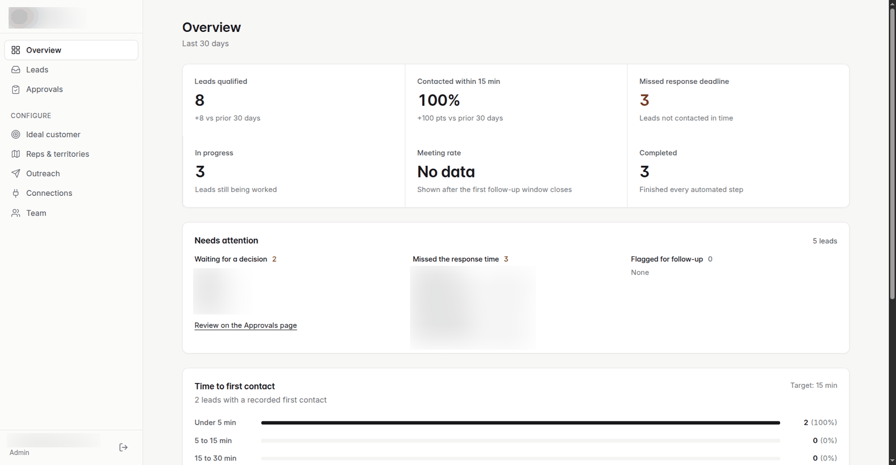
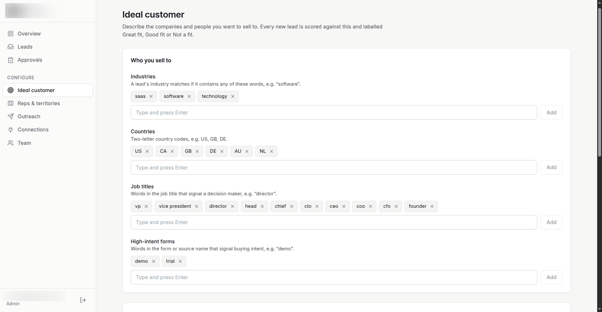
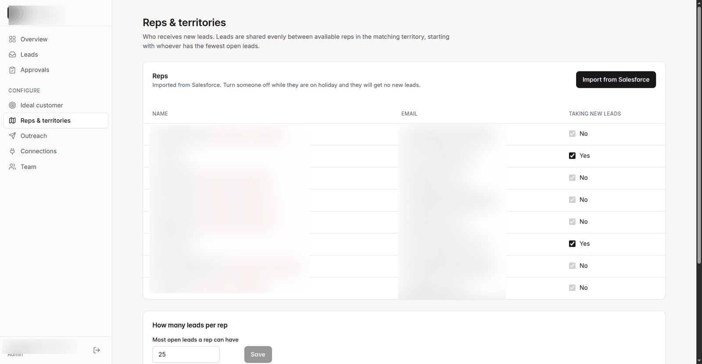
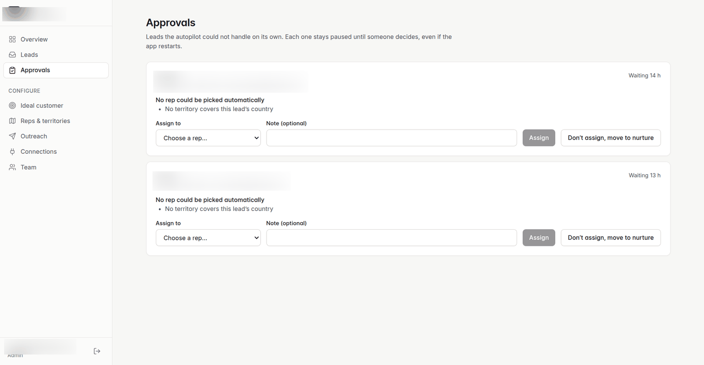
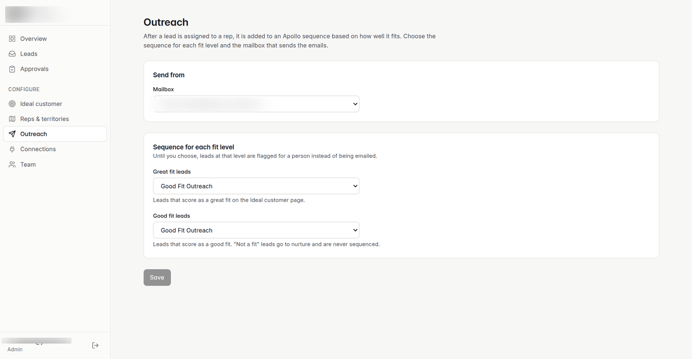
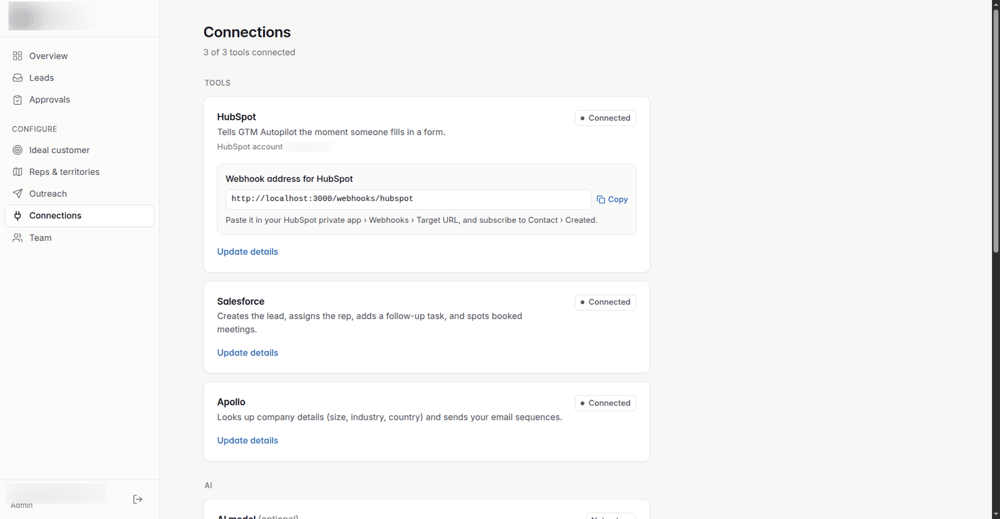
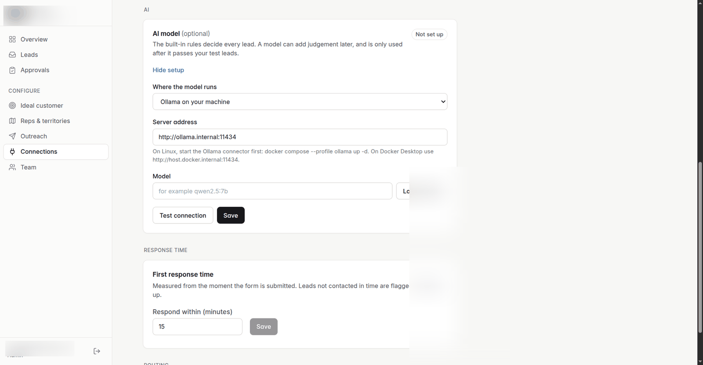
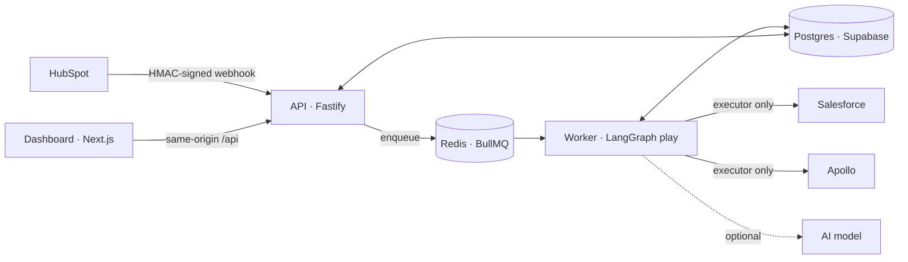

# GTM Autopilot

A self-hosted decision engine for inbound leads. A HubSpot form submission comes in; GTM Autopilot
enriches the company, scores fit against your ideal-customer settings, assigns an owner in
Salesforce with a call task, and enrolls the contact in the right Apollo sequence, typically in
seconds. Every decision is written to an append-only log together with the exact inputs,
settings and versions that produced it.

[](https://github.com/VallabhKulkarni-09/GTM_Autopilot/actions/workflows/ci.yml)
[](LICENSE)




---

## Contents

- [Why it exists](#why-it-exists)
- [What it does](#what-it-does)
- [Design](#design)
- [Optional AI](#optional-ai)
- [Quick start](#quick-start)
- [Configuration](#configuration)
- [Operating it](#operating-it)
- [Development](#development)
- [Project layout](#project-layout)
- [Limitations](#limitations)

---

## Why it exists

Inbound routing usually lives in a mix of CRM workflow rules, a round-robin plugin and a
spreadsheet of territories. It works until someone asks why a lead went to a particular rep, or
why nobody called it for two days, and the answer is spread across three systems with no history.

GTM Autopilot treats routing as a decision system rather than a set of triggers:

- **One place for the rules**, edited in plain language by the RevOps owner, not in code.
- **Every decision is explainable after the fact**: what the system knew, which settings applied
  (by version), and what it did.
- **Every side effect is safe to retry.** A crash or a redelivered webhook never creates a second
  Salesforce lead, task or sequence enrollment.

## What it does

| Area | Behaviour |
|---|---|
| **Fit scoring** | Industries, company size bands, countries, senior titles and high-intent forms, with weights and *Great fit* / *Good fit* thresholds. A preview scores a made-up lead before you save. |
| **Routing** | Country → territory → reps. Least-loaded rep first, ties broken by a persisted round-robin counter. Rep availability (holidays) and a per-rep open-lead cap. |
| **Outreach** | An Apollo sequence and sending mailbox per fit level, or manual follow-up. |
| **Response time** | Measured from form submission, not from when the system picked the lead up. Breaches surface under *Needs attention*. |
| **Human review** | When no rep can be chosen, the play pauses durably in *Approvals*. A decision resumes it at the same step, across restarts. |
| **Lead timeline** | Each step in plain language, with a *Developer details* view of the underlying record. |
| **Workspaces** | Multi-tenant, with admin and member roles. |

Integrations: **HubSpot** (form webhooks), **Salesforce** (leads, owners, tasks, meetings),
**Apollo** (organization enrichment, Sequences).

<table>
  <tr>
    <td width="50%"><br><b>Ideal customer.</b> Who you sell to, in plain words.</td>
    <td width="50%"><br><b>Reps & territories.</b> Imported from Salesforce, pausable per rep.</td>
  </tr>
  <tr>
    <td><br><b>Approvals.</b> Paused plays waiting on a person, with the reason.</td>
    <td><br><b>Outreach.</b> One Apollo sequence per fit level.</td>
  </tr>
  <tr>
    <td><br><b>Connections.</b> Each credential is tested live before it is stored.</td>
    <td><br><b>AI model.</b> Optional; gated on a built-in evaluation.</td>
  </tr>
</table>

---

## Design



The play itself is a LangGraph graph:
`validate → enrich → account match → qualify → route → (human review) → first touch → complete`.

### Invariants

These hold for every lead, and the test suite is organised around them.

1. **Decisions and side effects are separated.** Agents return a `ProposedAction`; it passes a
   risk check and a policy check; only the executor calls a connector. Agents have no access to
   connectors or the database.
2. **Every external write is idempotent.** Each action carries the key
   `organizationId:workflowRunId:actionId`, and the executor checks for a recorded success
   before calling out. Retries and redelivered jobs are no-ops.
3. **The event log is append-only.** Each action writes `action_proposed →
   action_execution_started → action_execution_succeeded | failed`; rows are never updated or
   deleted. Current state (`play_instance` and execution projections) lives in separate tables.
4. **Every event carries a decision snapshot** (`decision_snapshot`, `NOT NULL`): the lead, the
   company, active policies with versions, rep workloads, evidence ids, agent and prompt
   versions, and the model used, if any. The snapshot is sufficient to replay the decision.
5. **Tenant isolation is enforced server-side.** The workspace is resolved from the verified
   user's membership, never from the request body, query, path or token claims. Cross-tenant
   access returns `404`, so existence is not disclosed. Routes ship with cross-tenant tests.
6. **No silent defaults.** Missing configuration either fails or records an explicit
   `skipped` / `failed` event that the timeline can explain.
7. **Round-robin state is persisted** in `routing_state`. Never random, never in memory.
8. **Paused plays are durable.** LangGraph checkpoints are stored in Postgres, so an approval
   given tomorrow, after a deploy, resumes the same run at the same node.

### Failure handling

| Failure | Behaviour |
|---|---|
| Connector 429 / 503 / network | Bounded retries with backoff; typed `ConnectorError` with the provider's raw response kept |
| Connector 4xx | Not retried; recorded as a failed action with the provider's error code. Outreach failures are escalated to *Needs attention* |
| Worker crash mid-play | The job is retried; completed actions are skipped by idempotency |
| Webhook redelivery | Deduplicated by HubSpot event id before enqueueing |
| AI model slow, down or invalid | Rules decide; a `model_fallback` event records why |

More detail in [docs/architecture.md](docs/architecture.md).

---

## Optional AI

Rules are deterministic and auditable, but literal: `coo` matches "Marketing **Coo**rdinator" and
`technology` matches "Bio**technology**". An AI model can resolve those by meaning. It is
constrained so that it cannot weaken the guarantees above.

**Scope is deliberately narrow.**

| Agent | The model answers | Code still decides |
|---|---|---|
| Fit | industry / country / seniority / intent: `yes` · `no` · `unknown` | size bands, points, thresholds, personal-email and minimum-size gates |
| Routing | an ISO-3166 code, only when the country is free text ("Deutschland", "U.S.A.") | territories, availability, caps, round-robin |

**Controls**

- **Evaluation gate.** A 50-case golden dataset with labelled answers ships with the app. An agent
  can only be enabled after a completed run for that exact provider, model, model digest, prompt
  version and agent version. Changing any of them disables it again.
- **Constrained output.** Replies are schema-validated, with one repair attempt, then fallback to
  the rules.
- **Disagreement goes to a person.** If the model and the rules disagree on fit, the lead is
  routed to *Approvals* rather than silently nurtured or sequenced.
- **Prompt-injection resistant by construction.** Form text is passed as escaped data in a
  delimited block, the reply space is a handful of enums, and hard gates run before the model.
- **Data minimisation.** No names, email addresses or phone numbers are sent; only job title,
  email domain, form answers and company facts. Cloud providers require explicit consent per
  workspace; keys are encrypted at rest.
- **SSRF protection.** Self-hosted model addresses are resolved and checked before every request;
  metadata and link-local ranges are refused, and redirects are not followed.

**Measured on the golden set** (Gemini 3.5 Flash-Lite, temperature 0):

| | Fit | Routing |
|---|---|---|
| Rules only | 39 / 45 | 16 / 20 |
| Rules + model | **44 / 45** | **20 / 20** |

Supported: Google Gemini, OpenAI, Anthropic, OpenRouter, Ollama, and any OpenAI-compatible
server. Two thin adapters (OpenAI-compatible and Anthropic Messages), no provider SDKs.
Setup: [docs/ai-models.md](docs/ai-models.md).

---

## Quick start

Requirements: Docker with Compose, a [Supabase](https://supabase.com) project (free tier is
fine), and admin access to HubSpot, Salesforce and Apollo.

```bash
git clone https://github.com/VallabhKulkarni-09/GTM_Autopilot.git
cd GTM_Autopilot
cp .env.example .env              # fill in Supabase values, see below
docker compose up --build -d
```

Open <http://localhost:3001>, sign in with your email and create a workspace. The **Setup**
checklist covers connections, reps and territories, ideal customer, outreach, and a test lead
that runs every real step without affecting your metrics.

Compose starts the API (`:3000`), the worker, the dashboard (`:3001`) and Redis. A one-shot
`migrate` service applies pending migrations before the API and worker start.

---

## Configuration

### Environment

| Variable | Purpose |
|---|---|
| `SUPABASE_URL`, `SUPABASE_ANON_KEY`, `SUPABASE_SERVICE_KEY`, `SUPABASE_JWT_SECRET` | Supabase project (Project Settings → API) |
| `SUPABASE_DB_URL` | Postgres URI, used for migrations and durable checkpoints. Use the session pooler if the direct host is IPv6-only |
| `APP_ENCRYPTION_KEY` | 32 random bytes, base64. Encrypts stored credentials (AES-256-GCM). **Back it up** |
| `PUBLIC_API_URL` | Public HTTPS address of the API; HubSpot posts to `/webhooks/hubspot` |
| `DASHBOARD_URL` | Where users open the app; must match the Supabase Site URL |

```bash
node -e "console.log(require('crypto').randomBytes(32).toString('base64'))"   # APP_ENCRYPTION_KEY
```

Everything else (HubSpot, Salesforce, Apollo and AI credentials) is entered in the app, per
workspace, and stored encrypted. Every variable is documented in [`.env.example`](.env.example).

### Supabase

In **Authentication → URL Configuration**, set the Site URL to `DASHBOARD_URL` and add
`<DASHBOARD_URL>/auth/callback` as a redirect URL. Sign-in is by email link; configure your own
SMTP for anything beyond a trial.

### Integrations

| Tool | What you need |
|---|---|
| **HubSpot** | Private app with `crm.objects.contacts.read`; its access token and client secret (used to verify webhook signatures). Subscribe to *Contact → Created* at the address shown on the Connections page. |
| **Salesforce** | Connected App with the Client Credentials flow and a *Run As* integration user who can read Users and Events, create and edit Leads (including owner), and create Tasks. |
| **Apollo** | A master API key (Sequences enrollment needs it). |

HubSpot must reach the API over HTTPS. In production, put both ports behind a reverse proxy;
for a trial, `ngrok http 3000` is enough.

---

## Operating it

**Upgrades** are `git pull && docker compose up --build -d`. Migrations are tracked in
`schema_migrations` with checksums; an edited, already-applied migration is refused rather than
re-run.

**Backups.** All state is in Postgres, so use Supabase backups and keep `APP_ENCRYPTION_KEY` with
them. Without the key, stored credentials cannot be decrypted.

**Local models.** On Linux, `docker compose --profile ollama up -d` bridges the containers to an
Ollama listening on the host's loopback, without exposing it to the network. Use
`http://ollama.internal:11434` as the server address.

**Security.** Report vulnerabilities privately; see [SECURITY.md](SECURITY.md), which also covers
hardening.

---

## Development

```bash
npm ci && npm run build
eval "$(scripts/ci/test-db.sh)"     # disposable local Supabase, all migrations applied
CI=true npm run test:run            # CI=true: DB-backed suites must run, never skip
scripts/ci/test-db.sh stop

cd dashboard && npm ci
npx tsc --noEmit && npm run build
npx playwright install chromium && npx playwright test
```

**Test strategy**

- **Unit and route tests** (Vitest) for agents, policies, executor, connectors and API routes.
- **Isolation tests** (`tests/security/`) run the real tenant middleware and assert that another
  workspace's data is never read or written, and that it answers 404.
- **Workflow tests** drive the LangGraph play, including pause, restart and resume.
- **Golden-set tests** keep the dataset labels honest: the rules must agree with every case except
  those explicitly marked as rule failures, and must actually fail those.
- **End-to-end tests** (Playwright) run the real dashboard against a stub API.

CI runs typecheck, all of the above against a disposable database, the dashboard build and
Playwright, and a gitleaks scan. Contribution rules: [CONTRIBUTING.md](CONTRIBUTING.md).

**Stack:** Node 20, TypeScript (strict), Fastify, LangGraph JS, BullMQ + Redis, Supabase
(Postgres, Auth), Next.js 15, Tailwind, Vitest, Playwright.

---

## Project layout

```
src/
  agents/          fit and routing decisions: rule-based, plus the optional model-assisted versions
  actions/         risk and policy validation, the executor
  connectors/      HubSpot, Salesforce, Apollo (Clearbit, Outreach, Salesloft, ZoomInfo present, not wired in)
  evaluation/      golden dataset, replay over decision snapshots, model evaluation
  models/          AI provider adapters, SSRF guard, concurrency limits
  workflows/       the inbound-lead play (LangGraph)
  queue/           BullMQ queues, workers and scheduled jobs
  routes/          REST API
  middleware/      authentication and tenant resolution
dashboard/         Next.js app and Playwright tests
db/migrations/     numbered, checksummed SQL migrations
tests/             unit and cross-tenant isolation suites
docs/              architecture, AI models, screenshots
```

---

## Limitations

- One HubSpot portal per workspace.
- Email-link sign-in only.
- A changed response time applies to new leads; plays in flight keep their original deadline.
- AI assistance covers fit and country normalisation. Owner selection is always rule-based.

## License

[Apache License 2.0](LICENSE)
