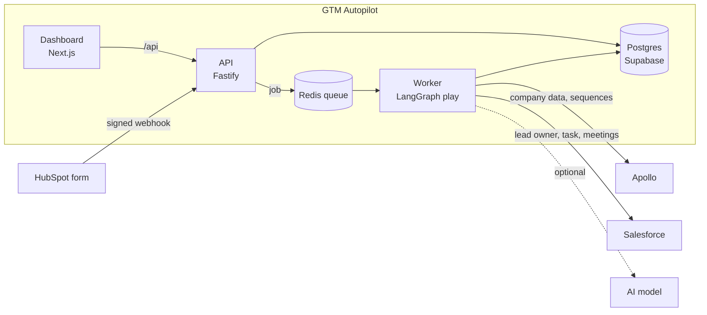
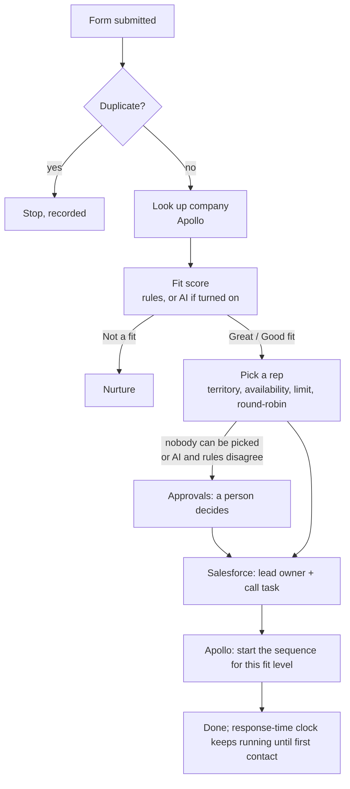

# Architecture

This page explains how GTM Autopilot is put together, for people who want to run, change or
review it. For setting it up, see the [README](../README.md).

## The big picture



| Part | What it does | Code |
|---|---|---|
| **API** | Receives HubSpot webhooks, serves the dashboard's `/api/*` routes, checks sign-in and roles | `src/app.ts`, `src/routes/` |
| **Worker** | Runs each lead through the play, plus the timed jobs (response-time check, meeting detection) | `src/queue/`, `src/workflows/` |
| **Dashboard** | The web app people use | `dashboard/` |
| **Database** | Leads, companies, settings, the event log, paused plays | `db/migrations/` |
| **Redis** | The job queue between the API and the worker | `src/queue/setup.ts` |

## What happens to a lead



The play is a [LangGraph](https://langchain-ai.github.io/langgraphjs/) graph
(`src/workflows/inbound-lead/graph.ts`). Each box is a node in `src/workflows/inbound-lead/nodes/`.
When a play waits for a person, its state is saved in Postgres, so it survives restarts and
continues from the same step after approval.

## How a decision is made and carried out

Nothing in GTM Autopilot changes Salesforce or Apollo directly from a decision. Every step goes
through the same pipeline:

```
Agent ──► Proposed action ──► Risk check ──► Policy check ──► Executor ──► Connector
(decides)  (what and why)      (how risky)    (your settings)  (does it)    (calls the tool)
```

- **Agents** (`src/agents/`) only decide. They cannot call Salesforce, Apollo or the database.
- **The executor** (`src/actions/`) is the only code that calls a connector. Every call has an
  idempotency key (`workspace:run:action`), so a retry never creates a second lead or task.
- **Connectors** (`src/connectors/`) wrap each tool's API and report failures as one error type,
  with the tool's own response kept for debugging.

## The event log

Every step writes to `event_log`, which is **append-only**: rows are never changed or deleted.
Each row has a **decision snapshot**: the lead, the company, the settings and their versions,
rep workloads, and which agent (and AI model, if any) decided. This is what the lead timeline
shows, and what makes it possible to replay old decisions against new rules or models
(`src/evaluation/replay.ts`).

An action always writes `action_proposed` → `action_execution_started` →
`action_execution_succeeded` or `action_execution_failed`.

## AI agents

Two agents can use an AI model. Both are off by default and can only be turned on after the
model has passed the built-in test leads.

| Agent | The model decides | Code always decides |
|---|---|---|
| Fit (`src/agents/qualification/llm.ts`) | Industry, country, seniority and intent: yes / no / unknown | Size, points, thresholds, personal-email and minimum-size rules |
| Routing (`src/agents/routing/llm.ts`) | The country code, only when the country is written as text | Territories, availability, lead limits, round-robin |

Safety rules that apply to both:

- Form text is passed to the model as data inside a delimited block, never as instructions.
- The reply must match a strict format; one retry, then the rules decide and a `model_fallback`
  event explains why.
- If the AI and the rules disagree on whether a lead fits, the lead goes to a person.
- Each workspace's key is encrypted. Self-hosted server addresses are checked against cloud
  metadata and link-local ranges before every request.

The test leads live in `src/evaluation/datasets/golden.ts` (50 made-up leads with known right
answers). A run is stored per provider, model, model version and prompt version; changing any of
them turns the agent off until it is tested again. More in [ai-models.md](ai-models.md).

## Workspaces and security

- Every table has `organization_id`. The API takes the workspace from the signed-in user's
  membership (`src/middleware/tenant-context.ts`), never from the request.
- Another workspace's records answer **404**, so their existence is not revealed. Tests in
  `tests/security/` check this for every route.
- Admins change settings; members can view. Write routes are listed in `ADMIN_WRITE_PREFIXES`
  (`src/app.ts`).
- HubSpot webhooks are accepted only with a valid signature.
- Credentials for HubSpot, Salesforce, Apollo and AI providers are encrypted with AES-256-GCM
  using `APP_ENCRYPTION_KEY` (`src/connectors/crypto.ts`).

## Timed jobs

| Job | Every | What it does |
|---|---|---|
| Response-time check | 2 minutes | Flags leads not contacted within the response time, measured from form submission |
| Meeting detection | 10 minutes | Looks for meetings booked in Salesforce for leads in a play |
| Outcome window | 1 hour | Marks plays "no meeting" once their attribution window has passed without one |

## Repository layout

```
src/
  agents/        fit and routing decisions (rules, and the optional AI versions)
  actions/       risk/policy checks and the executor
  connectors/    HubSpot, Salesforce, Apollo (others are present but not wired in)
  evaluation/    test leads, replay and model evaluation
  models/        AI provider adapters and safety checks
  queue/         job queue, workers and timed jobs
  routes/        API routes
  workflows/     the lead play (LangGraph)
dashboard/       web app (Next.js) and its browser tests
db/migrations/   numbered SQL migrations
tests/           unit and cross-workspace security tests
scripts/         CI test database, credential import, fixture capture
```

## Tech stack

Node 20 and TypeScript, Fastify, LangGraph JS, BullMQ with Redis, Supabase (Postgres and sign-in),
Next.js 15 with Tailwind, Vitest and Playwright.
